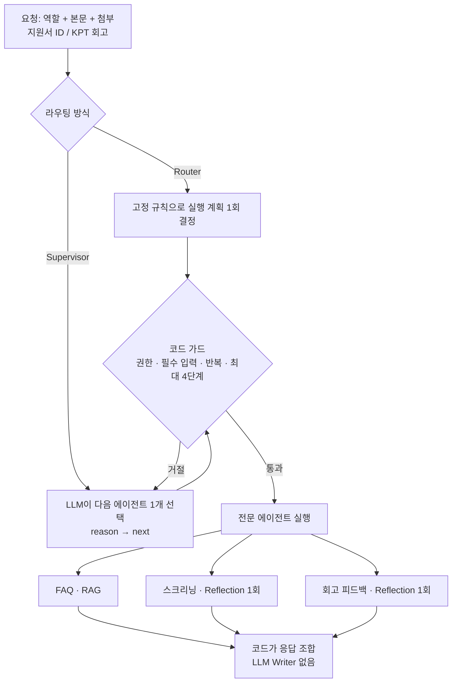

# Study Community AI Assistant · Multi-Agent 통합 데모

> 지원서 스크리닝(Reflection), 모집 FAQ(RAG), 주간 회고 피드백을 하나의 어시스턴트로 묶는 데모입니다. 다음에 실행할 에이전트를 **코드 Router**와 **LLM Supervisor** 두 방식으로 고르고, 같은 요청셋으로 비교합니다. 어떤 방식이든 실행 가능 여부와 종료는 코드 가드가 결정합니다.

옆 폴더의 두 데모를 복사하지 않고 그대로 불러 씁니다. 이 폴더만 따로 떼면 동작하지 않습니다.

```text
demos/
├── dahan_reflection_screeningAgent/   # 스크리닝: 백엔드·검증·데이터 재사용
├── dahan_rag_faqAgent/                # FAQ: FaqAgent·모집 공고 재사용
└── dahan_multiagent_assistant/        # 이 데모: 회고 피드백(신규) + 오케스트레이터
```

## 구조



| 에이전트 | 사용 가능 | 필수 입력 | 업무 결과(`outcome`) |
|---|---|---|---|
| FAQ | 지원자 · 스터디원 · 운영진 | 본문 | `answered` / `no_answer` / `blocked` / `rejected` |
| 스크리닝 | 운영진 | 지원서 ID (본문의 `A000` 형식 자동 인식) | `verified` / `needs_review` |
| 회고 피드백 | 스터디원 | KPT 회고 | `feedback` / `needs_review` / `needs_care` |

`status`는 시스템이 단계를 끝까지 수행했는지(`succeeded`/`failed`)만 나타냅니다(ADR 0002 초안). FAQ가 답을 거절해도 `succeeded`입니다. `failed`가 나오면 이후 에이전트는 실행하지 않습니다.

### 라우팅 두 방식

- **Router (baseline)**: 운영진이 지원서 ID를 주면 스크리닝, 스터디원이 회고를 첨부하면 회고 피드백, 둘 다 아니면 FAQ로 보냅니다. 앞 단계가 있고 본문에 질문 표현이 있으면 FAQ를 뒤에 붙입니다.
- **Supervisor**: 진행 상황(이미 시도한 에이전트, 결과)을 보고 `faq / screening / retro / FINISH` 중 하나를 고르는 것을 반복합니다. `SupervisorDecision`은 `reason`을 `next`보다 먼저 쓰게 했습니다.

### 코드 가드 (두 방식 공통)

| 코드 | 막는 것 |
|---|---|
| `permission` | 역할에 허용되지 않은 에이전트 (예: 지원자가 스크리닝 요청) |
| `missing_input` | 지원서 ID 없는 스크리닝, 회고 없는 회고 피드백 |
| `repeat` | 이미 시도한 에이전트를 다시 선택 |
| `max_steps` | Supervisor가 4번 안에 끝내지 않음 |

### 왜 Writer를 LLM으로 두지 않았나

스크리닝 등급과 인용, FAQ 출처는 코드 검증을 통과한 값입니다. LLM Writer가 이것을 다시 쓰면 검증한 내용이 바뀔 수 있어, 최종 응답은 에이전트별 메시지를 코드로 이어 붙입니다.

## 회고 피드백 에이전트 (신규)

KPT 회고 → 피드백 초안 → 코드 검증 + Critic → 치명 오류가 있으면 1회 수정 → 재검증.

- 피드백 항목마다 근거가 된 칸(`keep`/`problem`/`try`)과 그 칸에 그대로 있는 인용을 붙입니다.
- 치명 오류: 원문에 없는 인용, 빈 칸을 근거로 사용, Try를 썼는데 Try 제안이 없음, 성격·태도 단정.
- 경고: "열심히 하셨네요", "화이팅" 같은 누구에게나 할 수 있는 말.
- 번아웃·포기 같은 표현이 있으면 **LLM에 보내지 않고** 정해진 안내(운영진과 진도 조정 가능)만 돌려줍니다(`needs_care`).
- 다음 일정은 FAQ의 모집 공고에서 코드로 찾아 출처 청크 ID와 함께 붙입니다. RAG 지식 소스를 다른 에이전트가 함께 쓰는 지점입니다.
- 수정은 최대 1회이고, 1회 수정 후에도 치명 오류가 남으면 피드백을 내보내지 않고 `needs_review`로 운영진에게 넘깁니다.

## 실행

```bash
cd demos/dahan_multiagent_assistant
python -m venv .venv
source .venv/bin/activate          # Windows PowerShell: .venv\Scripts\Activate.ps1
pip install -r requirements.txt
python -m streamlit run app.py
```

```bash
python cli_demo.py                                      # Router vs Supervisor 비교 (시뮬레이션)
python cli_demo.py --role applicant "모임 몇 시예요?"      # 요청 하나
python cli_demo.py --strategy supervisor --role applicant "제 지원서 평가해 주세요"
pytest -q
```

실제 모드는 `.env.example`을 `.env`로 복사해 `OPENAI_API_KEY`를 넣고 `실제 OpenAI`를 선택합니다. 스크리닝은 기존 데모의 `OpenAIBackend`(langchain-openai)를, FAQ·회고·Supervisor는 openai SDK를 씁니다. 비용이 발생합니다.

## 비교 결과 (시뮬레이션)

`data/requests.json` 14건 (지원자 5 · 스터디원 6 · 운영진 3, 여러 에이전트가 필요한 요청 2건 포함).

| 방식 | 경로 정확도 | 결과 정확도 | 가드 거절 | 호출 수(모의 포함) |
|---|---:|---:|---:|---:|
| Router | 100% (14/14) | 92.9% (13/14) | 0 | 20 |
| Supervisor (모의) | 78.6% (11/14) | 71.4% (10/14) | 4 | 50 |

이렇게 읽어야 합니다.

- **시뮬레이션 Supervisor는 LLM이 아닙니다.** 역할·입력을 무시하고 키워드만 보고 고르는 실수를 일부러 재현한 규칙 기반 모의 객체입니다. 이 수치는 "가드가 잘못된 선택을 실행 전에 막는가"를 보여 줄 뿐, LLM Supervisor의 성능이 아닙니다.
- 가드는 4건을 모두 막았습니다. 다만 Supervisor가 막힌 뒤 FAQ로 안내하지 않고 끝낸 3건(R07, R11, R12)은 응답이 비었습니다. Router는 "해당 없음 → FAQ"라는 기본 경로가 코드에 있어 이 문제가 없습니다.
- **Router 100%는 요청셋과 규칙을 같은 사람이 만든 결과**입니다. 실제 비교에는 OpenAI 모드와, 규칙을 만들지 않은 사람이 작성한 요청셋이 필요합니다.
- 두 방식 모두 R04의 FAQ가 틀렸습니다. 공고에 없는 "출장 주간 규정"을 FAQ 시뮬레이션(어휘 검색)이 다른 문장으로 답했습니다. FAQ 데모의 알려진 한계와 같은 원인입니다.
- Supervisor는 매 단계 결정마다 호출이 하나씩 늘어 같은 요청에도 호출 수가 2.5배였습니다.

## 알려진 불일치

- 정기 모임 시간이 스크리닝 루브릭(`study.json`: 목요일 20시)과 모집 공고(목요일 19:30~21:30)에서 다릅니다. 이 데모는 그대로 두었고, ADR 0004 초안에서 한 곳으로 합치는 방안을 제안했습니다.
- 스크리닝 데모 자체는 LangGraph로 최대 5회까지 수정할 수 있지만, 이 데모에서는 LangGraph 없이 수정 1회로 실행합니다(ADR 0002 초안).

## 파일 구성

- `assistant/__init__.py`: 옆 데모 폴더 경로 연결
- `assistant/schemas.py`: 요청, `AgentOutput`, `SupervisorDecision`, 트레이스, 회고(KPT) 계약
- `assistant/agents.py`: FAQ·스크리닝·회고 어댑터, 권한 표
- `assistant/retro.py`: 회고 피드백 에이전트 (검증, 민감 내용 처리, 모의/OpenAI 백엔드)
- `assistant/routing.py`: Router 규칙, 가드, 모의/OpenAI Supervisor
- `assistant/orchestrator.py`: 실행 루프, 실패 시 중단, 응답 조합
- `assistant/evaluation.py`: 요청셋 로드와 두 방식 비교
- `data/requests.json`, `data/retros.json`: 합성 요청 14건, KPT 회고 4건
- `tests/`: 가드, 무한 루프 방지, 예외 처리, 회고 검증, 비교 회귀선
