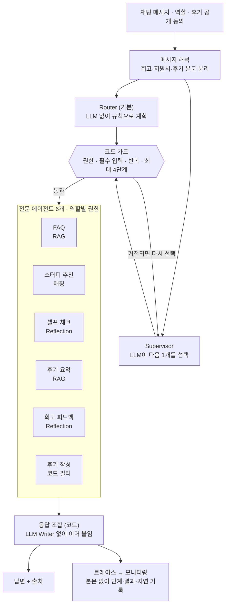

# 잇츠 스터디 커뮤니티 에이전트 요구사항 정의서

2026-11-26 · 작성: 다한

> 원본: [Claude 문서](https://claude.ai/artifact/R6PwsY2tY7ry3pb5WF5pp7) — 이 파일은 그 문서를 마크다운으로 옮긴 것입니다. 문서의 그림 두 개는 Mermaid 다이어그램과 표로 바꿨습니다.

## 1. 개요

우먼잇츠 참여 예정자와 참여자가 지원 전부터 스터디가 끝난 뒤까지 한 채팅창에서 스터디 정보, 스터디 추천, 지원서 점검, 회고 피드백, 이전 기수 후기를 얻는 커뮤니티 에이전트의 요구사항입니다. 11/26 POC 시연 구현을 기준으로 정리했고, 아직 정하지 않은 항목은 8장에 모았습니다.

### 목적

- 참여 예정자가 공식 자료와 이전 기수 경험을 근거로 스터디를 고르고 지원서를 준비하게 한다.
- 참여자가 스터디 중 회고에 근거 있는 피드백을 받고, 끝난 뒤 남긴 후기가 다음 기수의 자산이 되게 한다.
- 스터디에서 배운 세 아키텍처(Reflection, RAG, Multi-Agent)와 4개 모듈(스크리닝·매칭, FAQ, 회고 피드백, 오케스트레이터)을 하나의 서비스로 시연한다.

### 배경

- 잇츠 스터디 5기 "에이전트 아키텍처 랩"(8주)은 "LLM은 범주형 판단만, 최종 결정은 코드"(deterministic picker) 원칙으로 에이전트를 구현한다.
- 11/19 팀 회의에서 대상을 잇츠 스터디 신규 참여자로, 범위를 잇츠 스터디로, 접점을 공개 웹 채팅으로 정하고 모니터링·트레이싱을 함께 시연하기로 했다.
- 이후 운영진용 기능을 빼고 사용자를 참여 예정자·참여자로 통일했다. 스크리닝은 지원자용 셀프 체크로, 매칭은 스터디 추천으로 바꿨다.

### 범위

| 구분 | 항목 |
| --- | --- |
| 포함 | 지원 전 FAQ, 스터디 추천, 지원서 셀프 체크, 이전 기수 후기 요약, 회고 피드백, 후기 작성, 오케스트레이터(라우팅·가드·트레이스·모니터링), 시뮬레이션 모드와 OpenAI 모드 |
| 제외 | 운영진용 지원서 평가와 선발, 팀 배정, 자동 합격·불합격, 로그인·인증, 공개 웹 배포 인프라, 후기 공개 전 운영진 승인, 외부 웹 검색 |

### 용어

| 용어 | 뜻 |
| --- | --- |
| 참여 예정자 | 지원 전 사용자 (`applicant`) |
| 참여자 | 선발되어 스터디 중이거나 마친 사용자 (`member`) |
| 지식 베이스 | 답변 근거가 되는 공식 문서 묶음. 섹션 단위 청크로 나뉨 |
| 공개 조건 | 모집 공지에 공개된 신청 자격·일정·참고사항. 셀프 체크의 기준 |
| status / outcome | 시스템이 단계를 끝까지 수행했는가 / 단계가 낸 업무 결과(예: answered, no_answer) |
| 가드 | 에이전트 실행 전에 코드가 권한·입력·반복·단계 수를 확인하는 규칙 |
| 트레이스 | 요청 1건의 라우팅 단계, 가드 판정, 결과, 지연을 남긴 기록 |

## 2. 사용자와 이용 단계

사용자는 참여 예정자와 참여자 두 역할뿐이며, 역할에 따라 쓸 수 있는 기능이 다릅니다. 끝난 뒤 남긴 후기가 다음 기수 참여 예정자의 후기 요약 근거가 되어 흐름이 다시 처음으로 이어집니다.

| 단계 | 사용자 | 할 수 있는 일 | 에이전트 |
| --- | --- | --- | --- |
| 지원 전 | 참여 예정자 | 일정·자격·혜택·기수별 활동 질문 | FAQ |
| 지원 전 | 참여 예정자 | 관심사에 맞는 스터디 추천받기 | 스터디 추천 |
| 지원 전 | 참여 예정자 | 관심 스터디의 이전 기수 후기 보기 | 후기 요약 |
| 지원 직전 | 참여 예정자 | 지원서 초안을 공개 조건으로 스스로 점검 | 지원서 셀프 체크 |
| 진행 중 | 참여자 | 진행 일정·발표회 준비 질문 | FAQ |
| 진행 중 | 참여자 | 주간 KPT 회고에 피드백받기 | 회고 피드백 |
| 끝난 뒤 | 참여자 | 후기를 남기고 다음 기수에 익명 공개 | 후기 작성 |

- 역할은 사용자가 화면에서 고릅니다. 인증이 없으므로 역할 구분은 기능 안내용이며 접근 제어가 아닙니다.
- 운영진용 기능은 두지 않습니다. 운영진도 같은 화면에서 후기 요약을 볼 수 있습니다.
- 시연 시점은 "6기 참여 예정자"로 가정하고, 모집이 끝난 5기 스터디 20개는 지난 기수 예시로 보여 줍니다.

## 3. 기능 요구사항

에이전트 6개와 오케스트레이터·화면의 요구사항 54개입니다. 필수는 POC 시연에 구현되어 있어야 하고, 권장은 빠져도 시연이 가능한 항목입니다.

### 3.1 FAQ (RAG)

| ID | 요구사항 | 우선 |
| --- | --- | --- |
| FR-FAQ-01 | 지식 베이스 문서만 근거로 답한다. 웹 검색과 일반 상식은 쓰지 않는다. | 필수 |
| FR-FAQ-02 | 모든 답변에 출처 청크 ID, 문서명, 문서 버전, 원문 URL(있을 때)을 붙인다. | 필수 |
| FR-FAQ-03 | 초안의 인용이 검색된 청크 원문에 있는지 코드로 확인하고, 없으면 답변을 보류한다(rejected). | 필수 |
| FR-FAQ-04 | 검색 최고 점수가 하한보다 낮으면 답하지 않고 운영진 문의를 안내한다(no_answer). | 필수 |
| FR-FAQ-05 | 질문의 "N기"를 인식해 그 기수 청크만 검색한다. 지식 베이스에 없는 기수는 검색 없이 거절한다. | 필수 |
| FR-FAQ-06 | 선발 요청과 개별 지원서 평가 결과 요청은 LLM 호출 전에 차단한다(blocked). | 필수 |
| FR-FAQ-07 | 검색 개수는 1~5, 기본 3이다. 질문은 300자 이내다. | 권장 |

### 3.2 스터디 추천 (매칭)

| ID | 요구사항 | 우선 |
| --- | --- | --- |
| FR-REC-01 | 자유 입력에서 정해진 주제 라벨 14개, 기술 수준, 일정 언급 여부만 추출한다. | 필수 |
| FR-REC-02 | 점수와 정렬은 코드가 정한다: 일치한 주제 수, 동점이면 관심 밖 주제가 적은 스터디, 그다음 번호 순. 상위 3개를 보여 준다. | 필수 |
| FR-REC-03 | 일정·모집 대상·정원·진행 방식처럼 데이터가 없는 항목은 "확인 필요"로 표시하고 추측하지 않는다. | 필수 |
| FR-REC-04 | 맞는 스터디가 없으면 없다고 답하고, 열렸던 분야 목록을 보여 준다. | 필수 |
| FR-REC-05 | "모집 마감", "추천은 선발과 무관" 문구를 붙인다. | 필수 |
| FR-REC-06 | 나이·성별·직장 같은 개인 정보는 묻지도 추론에 쓰지도 않는다. | 필수 |
| FR-REC-07 | 프로그래밍 입문자에게는 신청 자격(기본 프로그래밍 경험)을 출처와 함께 안내한다. | 권장 |
| FR-REC-08 | 추천 뒤 "이 스터디 후기 보기"로 이어지는 안내를 붙인다. | 권장 |

### 3.3 지원서 셀프 체크 (스크리닝 변경, Reflection)

| ID | 요구사항 | 우선 |
| --- | --- | --- |
| FR-SC-01 | 공개 조건 5개(기본 프로그래밍 경험, 참석 가능한 일정, 스터디를 고른 이유, 만들거나 배우고 싶은 것, 함께 학습하려는 의지)를 기준으로 하고 각 조건의 출처 청크를 표시한다. | 필수 |
| FR-SC-02 | 항목별로 잘 드러남 / 보완하면 좋음 / 확인되지 않음 / 조건과 맞지 않을 수 있음 중 하나로 판정하고, 초안 원문 인용을 근거로 붙인다. | 필수 |
| FR-SC-03 | 점수·등급·합격 가능성을 말하지 않는다. 코드 검증이 치명 오류로 잡는다. | 필수 |
| FR-SC-04 | 지원서 문장을 대신 쓰지 않는다. 제안은 "무엇을 적으면 좋은지"까지만 한다. | 필수 |
| FR-SC-05 | 사실과 다르게 쓰라고 권하지 않는다. 필수 조건과 맞지 않으면 숨기지 말고 지원 전에 문의하라고 안내한다. | 필수 |
| FR-SC-06 | 코드 검증과 Critic이 치명 오류를 찾으면 1회만 수정하고, 수정 후에도 남으면 결과를 보여 주지 않는다. | 필수 |
| FR-SC-07 | 지원서 초안은 저장하지 않고 트레이스에도 남기지 않는다. 운영진이나 실제 심사로 넘어가지 않는다. | 필수 |
| FR-SC-08 | 초안에 연락처가 있으면 "신청서는 개인정보를 지운 뒤 리더에게 전달된다"는 안내를 붙인다. | 권장 |
| FR-SC-09 | 메시지의 스터디 번호나 이름을 인식해 결과 제목에 표시한다. 초안은 30~3,000자다. | 권장 |

### 3.4 이전 기수 후기 요약 (RAG)

| ID | 요구사항 | 우선 |
| --- | --- | --- |
| FR-RS-01 | 스터디 이름·번호 또는 기수로 후기를 고른다. 이름이 그대로 나오면 본문의 다른 단어보다 이름을 우선한다. | 필수 |
| FR-RS-02 | 좋았던 점 / 어려웠던 점 / 준비 팁으로 묶고, 후기 문장을 그대로 인용하며 "N건 중 M건"을 표시한다. | 필수 |
| FR-RS-03 | 후기가 3건 미만이면 요약하지 않고 원문을 최대 2건 보여 준다. 없으면 없다고 답한다. | 필수 |
| FR-RS-04 | 후기는 개인 경험이며 일정·자격은 공지를 따른다는 문구를 붙인다. | 필수 |
| FR-RS-05 | 합성 예시 후기는 건수와 인용마다 "예시"로 표시한다. | 필수 |
| FR-RS-06 | 모든 인용이 해당 후기 원문에 있는지 확인하고, 아니면 실패로 처리한다. | 필수 |

### 3.5 회고 피드백 (Reflection)

| ID | 요구사항 | 우선 |
| --- | --- | --- |
| FR-RT-01 | 메시지의 `Keep:` / `Problem:` / `Try:`(한글 별칭 포함)와 "N주차"를 인식한다. | 필수 |
| FR-RT-02 | 피드백 항목마다 근거가 된 KPT 칸과 그 칸의 원문 인용을 붙인다. | 필수 |
| FR-RT-03 | Try를 썼으면 다음 주 제안을 반드시 넣는다. 성격·태도 단정은 치명 오류, "화이팅" 같은 상투어는 경고다. | 필수 |
| FR-RT-04 | 번아웃·포기 같은 표현이 있으면 LLM에 보내지 않고 정해진 안내만 한다(needs_care). | 필수 |
| FR-RT-05 | 수정은 1회만 하고, 남으면 피드백을 내보내지 않는다(needs_review). | 필수 |
| FR-RT-06 | 다음 일정은 지식 베이스의 주차별 계획에서 코드로 찾아 출처와 함께 붙인다. | 권장 |

### 3.6 후기 작성

| ID | 요구사항 | 우선 |
| --- | --- | --- |
| FR-RW-01 | 공개 동의가 없으면 저장하지 않고, 동의하는 방법을 안내한다(not_shared). | 필수 |
| FR-RW-02 | 연락처·계정, 특정인 언급(○○님), 퇴사·건강 같은 개인 사정이 보이면 공개하지 않고 사유와 함께 보류한다(held). | 필수 |
| FR-RW-03 | 통과하면 이름 없이 기수·스터디와 함께 저장한다(published). | 필수 |
| FR-RW-04 | 저장한 후기는 바로 후기 요약에 포함된다. | 필수 |
| FR-RW-05 | 후기는 20~1,500자다. | 권장 |

### 3.7 오케스트레이터 (Multi-Agent)

| ID | 요구사항 | 우선 |
| --- | --- | --- |
| FR-OR-01 | 메시지에서 KPT 회고, 지원서 초안("지원서 봐줘" 아래), 후기 본문("후기:" 뒤)을 분리하고 나머지를 질문으로 넘긴다. | 필수 |
| FR-OR-02 | Router(고정 규칙, 기본)와 Supervisor(다음 에이전트를 하나씩 선택) 두 방식을 모두 제공한다. Supervisor 선택지는 에이전트 6개와 FINISH로 제한한다. | 필수 |
| FR-OR-03 | 실행 전 가드가 권한, 필수 입력, 반복, 최대 4단계를 확인해 거절한다. | 필수 |
| FR-OR-04 | 한 단계가 실패하면 이후 에이전트는 실행하지 않는다. 에이전트 예외는 실패 결과로 기록한다. | 필수 |
| FR-OR-05 | 최종 응답은 코드가 에이전트별 메시지를 이어 붙여 만든다. LLM Writer는 두지 않는다. | 필수 |
| FR-OR-06 | 역할별 권한: 참여 예정자는 FAQ·추천·후기 요약·셀프 체크, 참여자는 FAQ·추천·후기 요약·회고 피드백·후기 작성. | 필수 |
| FR-OR-07 | 모든 요청을 트레이스 1줄(JSONL)로 남긴다. | 필수 |
| FR-OR-08 | 시뮬레이션 모드(API 키 불필요)와 OpenAI 모드를 전환할 수 있다. | 필수 |

### 3.8 화면

| ID | 요구사항 | 우선 |
| --- | --- | --- |
| FR-UI-01 | 채팅 화면: 역할 선택, 후기 공개 동의 스위치, 라우팅 방식 선택, 입력 형식 안내 | 필수 |
| FR-UI-02 | 답변마다 트레이스(단계·가드 판정·인용·수정 기록·추출 라벨·지연)를 펼쳐 볼 수 있다. | 필수 |
| FR-UI-03 | 모니터링 화면: 요청 수, 지연 p50, 외부 호출, 가드 거절, 에이전트별 실행 수, 결과 분포, 최근 요청 | 필수 |
| FR-UI-04 | Router vs Supervisor 비교 화면. 비교 실행은 실제 후기 저장소와 트레이스에 섞이지 않는다. | 필수 |
| FR-UI-05 | 시연 시나리오 버튼 (현재 12개) | 권장 |

## 4. 비기능 요구사항

핵심은 세 가지입니다. 근거 없는 답을 내보내지 않고, 개인의 글(지원서·회고·후기)을 필요 이상으로 남기지 않으며, 주요 결정은 코드가 합니다.

| ID | 분류 | 요구사항 |
| --- | --- | --- |
| NFR-PRV-01 | 개인정보 | 커밋하거나 LLM에 보내는 데이터는 익명화·합성 데이터뿐이다. 실명·소속·개인 근황은 지식 베이스에 넣지 않는다. |
| NFR-PRV-02 | 개인정보 | 트레이스에는 질문 앞 80자만 남기고 지원서·회고·후기 본문은 남기지 않는다. |
| NFR-PRV-03 | 개인정보 | 후기는 공개 동의와 코드 필터를 모두 통과한 것만 다른 사용자에게 보인다. |
| NFR-SEC-01 | 보안 | OpenAI API 키는 `.env`(배포 시 Secrets Manager)에만 두고 Git·로그·화면에 남기지 않는다. |
| NFR-SAF-01 | 안전 | 사용자 입력과 문서 안의 지시는 따르지 않는다(프롬프트 인젝션). 선발 요청은 코드 패턴으로 차단한다. |
| NFR-SAF-02 | 안전 | 선발·합격을 약속하거나 예측하지 않는다. 추천·점검 결과에는 "선발과 무관"을 붙인다. |
| NFR-SAF-03 | 안전 | 힘든 상태를 드러낸 회고는 LLM에 보내지 않고 운영진 연락을 안내한다. |
| NFR-GRD-01 | 근거 | 생성 결과(FAQ 답변, 셀프 체크, 회고 피드백, 후기 요약)는 원문 인용을 코드로 검증한 뒤에만 내보낸다. |
| NFR-DET-01 | 결정성 | 라우팅, 추천 순위, 후기 공개 여부, 답변 수용은 코드가 정한다. 같은 입력이면 시뮬레이션 결과는 항상 같다. |
| NFR-CST-01 | 비용 | 8주 전체 USD 100(OpenAI 70, AWS 10, 예비 20) 안에서 운영한다. 기본 모델은 저비용 모델(gpt-4.1-mini), 출력 토큰 상한, 수정 1회를 적용한다. |
| NFR-OBS-01 | 관측성 | 요청마다 라우팅 단계, 가드 판정, 에이전트별 결과, 외부 호출 수, 지연을 기록하고 모니터링 화면에 집계한다. |
| NFR-PRF-01 | 성능 | 응답 지연을 측정·표시한다. 목표치는 실제 모드 측정 후 정한다(8장). |
| NFR-TST-01 | 검증 | 모든 규칙은 API 키 없이 고정 샘플 테스트로 확인할 수 있다. 가짜 LLM(모의 백엔드)을 에이전트마다 둔다. |
| NFR-MNT-01 | 유지보수 | 지식 베이스는 문서 파일을 추가하는 것만으로, 스터디 목록은 JSON을 바꾸는 것만으로 갱신된다. |

## 5. 데이터 요구사항

데이터는 네 종류이며, 지금은 초안·합성 데이터가 섞여 있어 표의 "상태"가 확정이 아닌 항목은 실제 자료로 바꿔야 합니다.

| 데이터 | 내용 | 출처 | 상태 |
| --- | --- | --- | --- |
| 지식 베이스: 5기 크루원 모집 공지 | 소개, 혜택, 자격, 일정·선발 절차, 참고사항 (청크 7개) | [우먼잇츠 공지(2026.09.01)](https://wtech.or.kr/sub/board/notice/222) 화면 | 확정 |
| 지식 베이스: 5기 보도자료 | 추진 기관·규모, 리더·크루원 대상, 발표회·심사 (청크 3개) | [내 손안에 서울(2026.07.15)](https://mediahub.seoul.go.kr/archives/2018778) | 확정 |
| 지식 베이스: 에이전트 아키텍처 랩 모집 공고 | 주제, 목표, 대상, 일정, 주차별 계획 (청크 16개) | 스터디 모집 공고 (리더 실명 제거) | 확정 |
| 지식 베이스: 기수별 활동 안내 | 1~5기 활동 자료 목록 (청크 7개) | 11/19 모임 메모 | 초안 |
| 지식 베이스: 발표회 준비 안내 | 심사자료 마감, 발표 팀 설정, 발표일 (청크 2개) | 11/19 모임 메모 | 초안 |
| 스터디 목록 | 5기 개설 스터디 20개: 번호, 분야 태그, 제목, 주제 라벨 | 5기 공지 | 일정·대상·정원·진행 방식 없음, 주제 라벨은 제목 기반 분류 |
| 후기 | 기수, 스터디, 본문, 합성 여부, 동의 여부, 작성 시각 | 예시 7건 + 사용자 작성분 | 예시는 합성 |
| 트레이스 | 요청별 시각, 모드, 라우팅 방식, 역할, 질문 앞 80자, 본문 유무, 경로, 결과, 단계, 가드 거절, 호출 수, 지연 | 실행 기록 | — |

### 형식 규칙

- 지식 베이스 문서는 frontmatter에 `source_id`, `version`, `title`, `cohort`, `doc_type`(official/review), `stage`(before/during/after), `url`을 적는다.
- 섹션은 `## <청크 ID> | <제목>` 형식이고 청크 ID는 문서 전체에서 유일하다. 한 줄에 한 문장으로 쓴다.
- 스터디 목록은 상세 항목(`schedule`, `format`, `target`, `capacity`, `detail_url`)을 비워 두면 추천에서 "확인 필요"로 표시된다.
- 후기와 트레이스는 실행 폴더의 `logs/`에 JSONL로 쌓이며 Git에 올리지 않는다. 보관 장소와 기간은 8장의 미결 사항이다.

## 6. 설계 원칙과 아키텍처

LLM은 범주형 라벨, 다음 에이전트 선택, 초안만 만들고, 실행 여부·정렬·공개 여부·최종 응답은 코드가 정합니다.

메시지는 본문을 분리한 뒤 Router나 Supervisor를 거쳐 가드를 통과한 에이전트만 실행되고, 결과는 코드가 이어 붙여 답변과 트레이스로 나갑니다.

### 원칙

1. **deterministic picker**: LLM은 정해진 선택지 안에서만 고른다(주제 라벨 14개, 에이전트 6개 + FINISH, 셀프 체크 판정 4가지).
2. **Reflection은 수정 1회**: 초안 → 코드 검증 + Critic → 치명 오류가 있으면 1회 수정 → 재검증. 남으면 내보내지 않는다.
3. **근거 없는 답은 실패한 답**: 모든 생성 결과는 원문 인용을 붙이고, 인용이 원문에 있는지 코드가 확인한다.
4. **status와 outcome 분리**: 답을 거절해도 정상 수행이면 succeeded다. failed가 나오면 이후 단계는 실행하지 않는다.
5. **LLM Writer 없음**: 검증을 통과한 인용·판정이 다시 쓰이며 바뀌지 않도록 최종 응답은 코드가 조합한다.
6. **에이전트 간 자율 루프 금지**: Supervisor도 최대 4단계이고, 같은 에이전트는 한 번만 실행된다.

### 구현 위치

| 구성 | 위치 |
| --- | --- |
| 통합 앱·오케스트레이터·추천·후기·회고 | `demos/dahan_multiagent_assistant/` |
| FAQ와 지식 베이스 | `demos/dahan_rag_faqAgent/` |
| 셀프 체크 (스크리닝 변경판) | `demos/dahan_reflection_screeningAgent/screening/selfcheck.py` |
| 관련 설계 결정 초안 | `docs/adr/0001`~`0005` |

## 7. 평가와 수용 기준

지금 수치는 모두 시뮬레이션 모드 측정값이며 LLM 성능이 아닙니다. 스터디 목표인 "E2E 성공률 80% 이상"과 "정확도·응답시간·비용 중 1개 이상 실측"은 OpenAI 모드로 아직 측정하지 않았습니다.

| 지표 | 정의 | 평가셋 | 현재(시뮬레이션) | 목표 |
| --- | --- | --- | --- | --- |
| FAQ 응답 상태 정확도 | 기대 상태(answered/no_answer/blocked)와 일치한 비율 | FAQ 질문 31건 | 87.1% (27/31) | 실제 모드에서 측정 후 결정 |
| FAQ Hit@3 | 정답 청크가 상위 3개에 든 비율 | 답이 있는 25건 | 100% (25/25) | 유지 |
| FAQ 인용 정밀도 | 답한 경우 인용 청크가 정답인 비율 | 답한 27건 | 63.0% (17/27) | 실제 모드에서 측정 후 결정 |
| 라우팅 경로 정확도 (Router) | 기대한 에이전트 순서와 일치 | 요청 18건 | 100% (18/18) | — |
| 라우팅 경로 정확도 (Supervisor) | 같음 | 요청 18건 | 94.4% (17/18), 모의 객체 | 실제 LLM으로 비교 |
| 가드 거절 | 잘못된 선택을 실행 전에 막은 건수 | 요청 18건 | Router 0, Supervisor 2 | 잘못된 선택은 모두 실행 전 차단 |
| 외부 호출 수 | 요청셋 전체 호출(모의 포함) | 요청 18건 | Router 14, Supervisor 52 | 비용 한도 안 |
| E2E 성공률 | 기대 경로 + 기대 결과 + 인용 일치를 모두 만족한 요청 비율 | 참여 단계별 시나리오 요청셋 | 미측정 | 80% 이상 (실제 모드) |
| 응답 지연·비용 | 요청당 지연, 토큰·비용 | 위와 같음 | 미측정 | 1개 이상 실측 |

- Router 100%는 요청셋과 규칙을 같은 사람이 만든 결과다. 실제 비교에는 다른 사람이 쓴 요청셋이 필요하다.
- 시뮬레이션 FAQ는 글자 겹침 검색이라 참가비·주차장·날씨 질문에 엉뚱하게 답한다.

### POC 수용 기준 (11/26 시연)

- [ ] 테스트 통과: 통합 데모 53개, FAQ 32개 (시뮬레이션, 로컬 실행)
- [ ] 시나리오 버튼 12개가 시뮬레이션 모드에서 기대한 경로와 결과로 동작
- [ ] 같은 버튼이 OpenAI 모드에서 오류 없이 동작
- [ ] 모니터링 화면에 시연 중 요청이 기록되고, 트레이스에 지원서·회고·후기 본문이 없음
- [ ] 후기를 공개 동의로 작성하면 같은 스터디 후기 요약 건수가 1 늘어남

## 8. 제약·가정·미결 사항

가장 큰 미결 사항은 후기 저장소입니다. 후기는 기수를 넘어 남아야 하는데, 레포 설계는 데이터베이스를 범위에서 제외합니다.

### 제약

- 비용: 8주 전체 USD 100 (OpenAI 70, AWS 10, 예비 20).
- 데이터: 커밋하거나 LLM에 보내는 것은 익명화·합성 데이터뿐이다.
- 기술: Python, OpenAI API. 공통 레포는 AWS 서버리스(API Gateway, Lambda, Step Functions)이고, 이 데모는 로컬 Streamlit이다.
- 레포 원칙: 에이전트끼리 자율적으로 주고받는 루프는 두지 않고, Reflection 수정은 최대 1회다.

### 가정

- 시연 시점은 "6기 참여 예정자"이며, 5기 스터디는 지난 기수 예시다.
- 역할은 사용자가 고르며 인증하지 않는다.
- 셀프 체크의 기준은 공지에 공개된 조건이며, 내부 루브릭은 쓰지 않는다.

### 결정이 필요한 항목

| 항목 | 내용 | 결정할 사람 |
| --- | --- | --- |
| 후기 저장소 | 저장하지 않음 / S3 JSON / DynamoDB 중 선택 (ADR 0005 초안) | 리더, 팀 |
| 후기 공개 전 검토 | 코드 필터 뒤에 운영진 승인 단계를 둘지 | 운영진, 리더 |
| 실제 후기 수집 | 11/22 작성 후기의 공개 동의와 익명화 뒤 예시 후기 교체 | 팀 |
| 5기 스터디 상세 | 스터디별 일정·대상·정원·진행 방식 확보, 주제 재분류 | 팀 |
| 발표회 가이드 | 재단의 발표회 참가·심사자료 가이드 본문으로 초안 교체 | 리더 |
| 정기 모임 시간 | 모집 공고(목 19:30~21:30)와 스크리닝 루브릭(목 20시)이 다름 | 리더 |
| 공개 웹 배포 | 채팅 UI 호스팅, 인증, 로그 보관 기간과 접근 권한 | 인프라 담당 |
| 팀 통합 진입점 | 다른 팀원 모듈과 맞출 `answer(message) -> {reply, citations, trace}` 계약 | 팀 |
| 실제 모드 임계값 | FAQ 검색 점수 하한(현재 초깃값 0.30), 응답 지연 목표 | 구현자 (측정 후) |

## 9. 일정과 로드맵

오늘 POC 시연 다음 마감은 11/27 심사자료 제출이고, 12/16 프로젝트 발표회까지 3주가 남았습니다.

| 날짜 (2026) | 일정 |
| --- | --- |
| 11월 26일 | POC 시연 (팀 내부) |
| 11월 27일 | 심사자료 제출 마감 |
| 11월 30일 | 스터디 활동 종료 |
| 12월 4일 | 발표자 팀 설정 |
| **12월 16일** | **프로젝트 발표회** |

출처: 11/19 모임에서 공유한 일정과 5기 공지.

발표회 전까지 8장의 실제 모드 측정, 예시 후기 교체, 초안 문서 교체를 마치는 것을 권합니다.

### 발표회 이후 (6기 준비)

- 후기 저장소 결정과 공개 전 검토 절차 마련
- 6기 모집 공지와 스터디 목록(일정·대상 포함)으로 지식 베이스와 추천 갱신
- 공개 웹 배포와 인증, 로그 보관 정책
- 기수별 스터디 노트·후기를 쌓아 "N기 어느 스터디의 6주차 내용"까지 답하는 장기 비전
