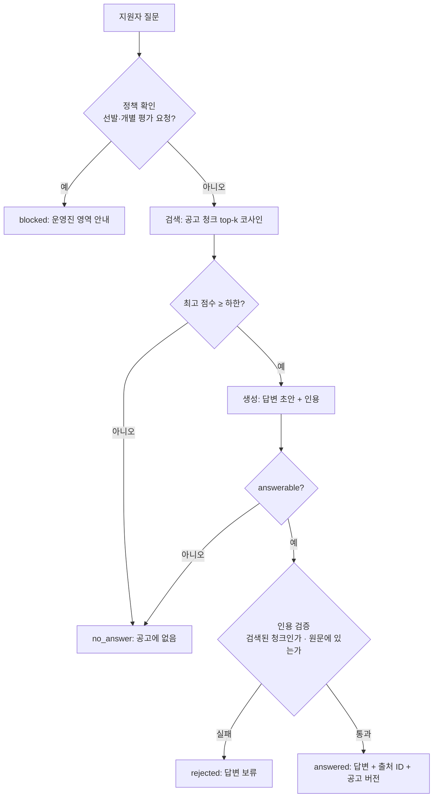

# 스터디 모집 FAQ 에이전트 (RAG)

> 스터디 지원자가 모집 공고에 대해 묻는 질문에 **공고에 적힌 내용만 근거로** 답하고, 모든 답변에 출처 청크를 붙이는 데모입니다. 공고에 없는 내용은 답하지 않고 운영진 문의로 안내합니다.

전체 흐름에서의 위치: 모집 공고 게시 → 지원자 질문은 **FAQ 에이전트(이 데모)** → 접수된 지원서는 Reflection 스크리닝·매칭 에이전트(`demos/dahan_reflection_screeningAgent`).

## 구조



LLM은 초안만 만듭니다. 차단, 답변 거절, 인용 수용 여부, 출처 표기는 모두 코드가 결정합니다.

| 단계 | 시뮬레이션 모드 (API 키 불필요) | 실제 OpenAI 모드 |
|---|---|---|
| 임베딩 | 음절 bigram TF-IDF (`LexicalEmbedder`) | `text-embedding-3-small` |
| 검색 | 인메모리 코사인 top-3 | 동일 |
| 생성 | 질문과 가장 많이 겹치는 문장 1개 추출 (`ExtractiveGenerator`) | `gpt-4.1-mini` 구조화 출력 (`FaqDraft`) |
| 검증 | 코드 (`validation.py`) | 동일 |

## 실행

Python 3.10+ 환경에서:

```bash
cd demos/dahan_rag_faqAgent
python -m venv .venv
source .venv/bin/activate          # Windows PowerShell: .venv\Scripts\Activate.ps1
pip install -r requirements.txt
python -m streamlit run app.py
```

```bash
python cli_demo.py                           # 평가 질문셋 전체 (시뮬레이션)
python cli_demo.py "모임은 언제 하나요?"        # 질문 하나
pytest -q
```

실제 모드는 `.env.example`을 `.env`로 복사해 `OPENAI_API_KEY`를 넣고 앱에서 `실제 OpenAI`를 선택합니다. 비용이 발생합니다(질문당 임베딩 1회 + 생성 1회, 앱 시작 시 청크 임베딩 1회).

## 지식 소스

`data/recruitment_post.md`: 모집 공고를 `## <청크 ID> | <제목>` 섹션 16개로 정리한 문서입니다.

- frontmatter의 `version`이 모든 답변의 출처 표기에 붙습니다. 공고가 바뀌면 version을 올립니다.
- 청크 ID는 고정입니다. 섹션을 추가할 때는 새 번호를 쓰고 기존 번호를 재사용하지 않습니다.
- 한 줄에 한 문장으로 씁니다. 인용 검증과 추출형 생성이 줄 단위 문장을 기준으로 동작합니다.
- 레포 원칙(익명화·합성 데이터만 커밋)에 따라 **리더 실명과 소속은 제거**했습니다.

## 평가

`data/eval_questions.json`: 답이 있는 질문 13개, 공고에 없는 질문 3개, 차단해야 할 요청 2개.

| 지표 | 정의 | 시뮬레이션 결과 |
|---|---|---:|
| 응답 상태 정확도 | 기대 상태(answered / no_answer / blocked)와 일치한 비율 | 88.9% (16/18) |
| Hit@3 | 답이 있는 질문에서 정답 청크가 top-3에 든 비율 | 100% (13/13) |
| 인용 정밀도 | 실제로 답한 경우 인용한 청크가 정답 청크인 비율 | 92.3% (12/13) |
| 외부 API 호출 | 시뮬레이션 | 0 |

시뮬레이션 실패 사례 2건은 어휘 기반 검색의 한계를 보여 주는 사례라 일부러 남겨 두었습니다.

- **Q11 "교재로 무엇을 사용하나요?"**: 정답 청크를 찾았지만 점수(0.118)가 하한(0.12)에 조금 못 미쳐 답하지 않았습니다.
- **Q15 "주차 지원이 되나요?"**: 주차(parking)를 묻는 질문인데 "주차별 계획"과 글자가 겹쳐 엉뚱한 일정 문장으로 답했습니다. 의미 임베딩(실제 모드)과 생성기의 `answerable=false` 판단으로 걸러져야 하는 사례입니다.

**한계**: 질문셋이 작고 점수 하한도 같은 질문셋을 보고 정했으므로 일반화된 성능 수치가 아닙니다. 실제 모드의 `min_score=0.30`은 아직 측정하지 않은 초기값이며, 실제 질문으로 조정해야 합니다. 인용 검증은 문자열 일치만 확인하며 답변 문장이 인용을 정확히 요약했는지는 보증하지 않습니다.

## 파일 구성

- `app.py`: Streamlit UI (질문하기 / 평가 질문셋 / 지식 소스)
- `cli_demo.py`: 터미널 실행과 평가
- `faq/schemas.py`: `Chunk`, `FaqDraft`, `FaqResult` 등 입출력 계약
- `faq/chunking.py`: frontmatter·섹션 파싱, 청크 ID 검증, 문서 해시
- `faq/embeddings.py`: 어휘 / OpenAI 임베더 (`min_score` 하한 포함)
- `faq/retriever.py`: 인메모리 인덱스와 코사인 top-k
- `faq/generators.py`: 추출형 / OpenAI 생성기
- `faq/validation.py`: 정책 차단 패턴, 인용 검증
- `faq/pipeline.py`: `FaqAgent.answer()` — 다른 에이전트가 호출할 진입점
- `faq/evaluation.py`: 평가 지표 계산
- `tests/`: 청킹, 차단, 인용 위조·누락·미검색 청크, 평가 회귀선
