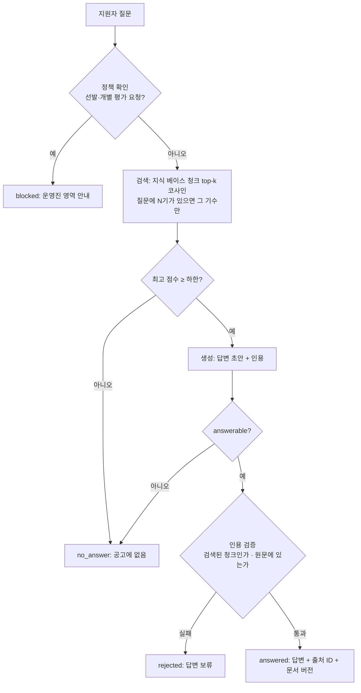

# 잇츠 스터디 FAQ 에이전트 (RAG)

> 잇츠 스터디 신규 참여자의 질문에 **지식 베이스(모집 공고, 기수별 활동 안내)에 적힌 내용만 근거로** 답하고, 모든 답변에 출처 청크를 붙이는 데모입니다. 자료에 없는 내용은 답하지 않고 운영진 문의로 안내합니다.

통합 어시스턴트(`demos/dahan_multiagent_assistant`)에서는 이 에이전트가 신규 참여자 질문을 맡습니다.

## 구조



LLM은 초안만 만듭니다. 차단, 답변 거절, 인용 수용 여부, 출처 표기는 모두 코드가 결정합니다.

| 단계 | 시뮬레이션 모드 (API 키 불필요) | 실제 OpenAI 모드 |
|---|---|---|
| 임베딩 | 음절 bigram TF-IDF (`LexicalEmbedder`) | `text-embedding-3-small` |
| 검색 | 인메모리 코사인 top-3 | 동일 |
| 생성 | 질문과 가장 많이 겹치는 문장 1개 추출 (`ExtractiveGenerator`) | `gpt-4.1-mini` 구조화 출력 (`FaqDraft`) |
| 검증 | 코드 (`validation.py`) | 동일 |

## 실행

Python 3.10+ 환경에서:

```bash
cd demos/dahan_rag_faqAgent
python -m venv .venv
source .venv/bin/activate          # Windows PowerShell: .venv\Scripts\Activate.ps1
pip install -r requirements.txt
python -m streamlit run app.py
```

```bash
python cli_demo.py                           # 평가 질문셋 전체 (시뮬레이션)
python cli_demo.py "모임은 언제 하나요?"        # 질문 하나
pytest -q
```

실제 모드는 `.env.example`을 `.env`로 복사해 `OPENAI_API_KEY`를 넣고 앱에서 `실제 OpenAI`를 선택합니다. 비용이 발생합니다(질문당 임베딩 1회 + 생성 1회, 앱 시작 시 청크 임베딩 1회).

## 지식 소스

`data/kb/` 폴더의 `*.md` 전체가 지식 베이스입니다(청크 35개). 문서를 추가하면 다시 시작할 때 자동으로 포함됩니다.

| 문서 | 내용 | 단계 | 출처 |
|---|---|---|---|
| `its5_crew_notice.md` | 5기 크루원 모집 공지: 소개, 혜택, 자격, 일정·선발 절차, 참고사항 | 지원 전 | 우먼잇츠 공지(2026.09.01) |
| `its5_press_release.md` | 5기 추진 기관·규모, 리더·크루원 대상, 발표회와 심사 | 지원 전 | 서울시 내 손안에 서울(2026.07.15) |
| `recruitment_post.md` | 5기 에이전트 아키텍처 랩 모집 공고(주차별 계획 포함) | 지원 전 | 스터디 모집 공고 |
| `its_study_overview.md` | 잇츠 스터디 1~5기 활동 안내 — **초안, 실제 공개 페이지로 교체 필요** | 지원 전 | 11/19 모임 메모 |
| `its5_demo_day_prep.md` | 발표회 준비 일정 — **초안, 재단 가이드 본문으로 교체 필요** | 진행 중 | 11/19 모임 메모 |

- frontmatter에 `version`, `cohort`, `doc_type`, `stage`, `url`을 적습니다. `version`과 `url`은 답변 출처에 붙습니다.
- 섹션 형식은 `## <청크 ID> | <제목>`이고, 청크 ID는 문서 전체에서 유일해야 합니다(`notice-`, `press-`, `recruit-`, `its-`, `prep-`).
- 한 줄에 한 문장으로 씁니다. 인용 검증과 추출형 생성이 줄 단위 문장을 기준으로 동작합니다.
- 실명과 개인 근황은 넣지 않고, 공개된 내용만 넣습니다.

### 기수 필터

질문에 `5기`, `3기는`처럼 기수가 나오면 그 기수를 다루는 청크 안에서만 검색합니다. 지식 베이스에 없는 기수(예: 6기)를 물으면 검색하지 않고 "N기 자료는 아직 없습니다"라고 답합니다.

## 평가

`data/eval_questions.json` 31건: 답이 있는 질문 25, 자료에 없는 질문 4, 없는 기수 1, 차단해야 할 요청 2.

| 지표 | 정의 | 시뮬레이션 결과 |
|---|---|---:|
| 응답 상태 정확도 | 기대 상태(answered / no_answer / blocked)와 일치한 비율 | 87.1% (27/31) |
| Hit@3 | 답이 있는 질문에서 정답 청크가 top-3에 든 비율 | 100% (25/25) |
| 인용 정밀도 | 실제로 답한 경우 인용한 청크가 정답 청크인 비율 | 63.0% (17/27) |
| 외부 API 호출 | 시뮬레이션 | 0 |

시뮬레이션(음절 bigram 검색 + 문장 추출)은 검색은 잘하지만 문장 고르기가 약합니다.

- 상태 오류 4건: Q11(교재)은 점수가 하한 아래라 답하지 않았습니다. Q14(참가비)는 발표회 "참가"와, Q15(주차장)는 "주차별 계획"과, Q16(서울 날씨)은 "서울 우먼잇츠"와 글자가 겹쳐 엉뚱하게 답했습니다.
- 인용 오류 10건: 정답 청크를 찾고도 다른 청크의 문장을 고른 경우입니다.

문서가 늘수록 어휘 기반 검색은 흔들립니다. **시연은 실제 OpenAI 모드로 하고 시뮬레이션은 예비로 두는 것을 권합니다.**

**한계**: 질문셋이 작고 점수 하한도 같은 질문셋을 보고 정했으므로 일반화된 성능 수치가 아닙니다. 실제 모드의 `min_score=0.30`은 아직 측정하지 않은 초기값입니다. 인용 검증은 문자열 일치만 확인합니다.

## 파일 구성

- `app.py`: Streamlit UI (질문하기 / 평가 질문셋 / 지식 소스)
- `cli_demo.py`: 터미널 실행과 평가
- `faq/schemas.py`: `Chunk`, `FaqDraft`, `FaqResult` 등 입출력 계약
- `faq/chunking.py`: frontmatter·섹션 파싱, 청크 ID 검증, 문서 해시
- `faq/embeddings.py`: 어휘 / OpenAI 임베더 (`min_score` 하한 포함)
- `faq/retriever.py`: 인메모리 인덱스와 코사인 top-k
- `faq/generators.py`: 추출형 / OpenAI 생성기
- `faq/validation.py`: 정책 차단 패턴, 인용 검증
- `faq/pipeline.py`: `FaqAgent.answer()` — 다른 에이전트가 호출할 진입점
- `faq/evaluation.py`: 평가 지표 계산
- `tests/`: 청킹, 차단, 인용 위조·누락·미검색 청크, 평가 회귀선
