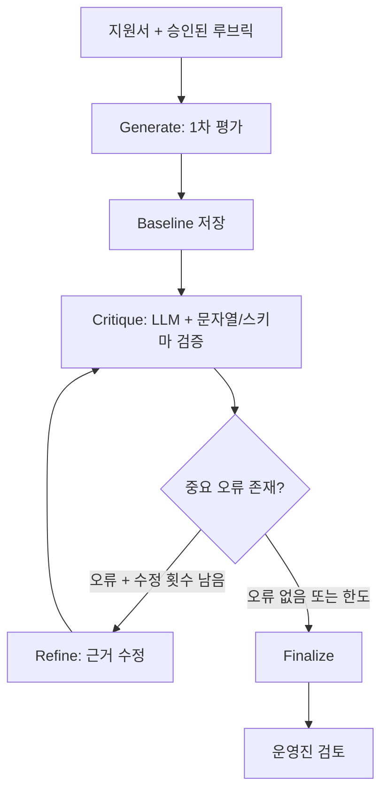

# Reflection 기반 커뮤니티 스터디 지원서 스크리닝 데모

> 지원자 선발을 자동화하는 시스템이 아닌, **지원서 적합성 평가에 사용한 근거를 검증하고 운영진의 판단을 돕는 데모**입니다.

## 목표

- 지원서에서 항목별 평가 등급과 인용 근거 추출
- Critic으로 근거 오류와 평가 기준 위반 감수
- Refiner로 오류를 보완하고 재검증
- 동일한 1차 평가를 공유해 **Baseline(단일 평가)과 Reflection** 비교
- Streamlit에서 평가 원문, 수정 결과, 오류 이력 확인

## 구조



## 실행

Python 3.10+ 환경에서:

```bash
cd study_screening_demo
python -m venv .venv
# macOS / Linux
source .venv/bin/activate
# Windows PowerShell: .venv\Scripts\Activate.ps1
pip install -r requirements.txt
python -m streamlit run app.py
```

브라우저에서 표시되는 **시뮬레이션 모드**는 API 키 없이 동작합니다. 고정된 샘플 5명의 **첫 평가에만 가짜 인용 하나를 삽입**해 검증과 수정 흐름을 보여줍니다. 실제 모델의 효과를 측정한 결과가 아닙니다.

실제 LLM 평가를 사용하려면 `.env.example`을 `.env`로 복사하고 `OPENAI_API_KEY`를 설정한 후 앱에서 `실제 OpenAI LLM`을 선택하세요. 실제 API 요청에 따른 비용이 발생합니다. 민감한 실제 지원서는 개인식별정보를 제거하고 사용하세요.

CLI 테스트:

```bash
python cli_demo.py
pytest -q
```

## 평가 기준 (예시)

| 항목 | 비중 | 의미 |
|---|---:|---|
| 주제 적합성 | 30% | 스터디 주제와 지원 동기의 부합 |
| 참여 조건 | 25% | 목요일 20시 및 8주 참석 가능성 |
| 기술적 준비도 | 20% | 필수 Python 기초 |
| 학습 목표 구체성 | 15% | 배우고 만들고 싶은 결과의 구체성 |
| 협업 준비도 | 10% | 협업 의지와 기여 계획 |

등급 0~4, 확인할 수 없는 정보는 `grade=null` / `status=unknown`으로 표시합니다. **판단 불가 항목이 있으면 종합점수는 `null`**입니다. 점수만으로 선발하지 않습니다.

## 파일 구성

- `app.py`: Streamlit UI 및 Baseline 비교 화면
- `cli_demo.py`: 전체 샘플의 터미널 비교
- `screening/schemas.py`: 구조화 출력 Pydantic 모델
- `screening/prompts.py`: Generator / Critic / Refiner 프롬프트
- `screening/backends.py`: 실제 LLM / 고정 시뮬레이션 구현
- `screening/validation.py`: 근거 인용 문자열·스키마 검증 및 점수 집계
- `screening/engine.py`: LangGraph Reflection 워크플로 및 반복 제한
- `screening/runner.py`: 공통 초안 기반 Baseline과 Reflection 비교
- `data/study.json`: 승인된 예시 모집 조건과 루브릭
- `data/applications.json`: 5명 가상 지원서
- `data/mock_labels.json`: 시뮬레이션 모드의 고정 평가 값
- `tests/test_screening.py`: 샘플 5건, 반복 제한, 판단 불가 테스트
- `Notion_Reflection_Screening_Demo.md`: Notion에 가져올 전체 설명 + 모든 코드

## 평가와 한계

- **인용 일치율** = 지원서 원문에 질문 ID와 정확한 인용 문자열이 존재하는 비율. 의미적 타당성까지 보증하지 않습니다.
- Critic이 근거의 의미적 타당성과 누락을 검토하지만 LLM 판단에는 오류가 남을 수 있습니다.
- 고정된 시뮬레이션의 100%는 미리 설계한 가짜 인용 오류를 고친 결과일 뿐, 실제 모델 성능을 의미하지 않습니다.
- 실제 Reflection 효과 검증에는 운영진의 근거별 정답 주석, 블라인드 평가, 반복 실행, 비용과 지연시간 측정이 필요합니다.
- 운영진의 최종 결정만 지원하며 합격·불합격을 자동화하지 않습니다.

## 설계 참고

- 업로드된 `01_reflection.ipynb`: Generate → Critique → Refine → Finalize, 두 역할, 반복 한도와 이력
- LangGraph StateGraph 문서: https://reference.langchain.com/python/langgraph/graph/state/StateGraph/add_conditional_edges
- LangChain OpenAI structured output: https://reference.langchain.com/python/langchain-openai/chat_models/base/ChatOpenAI/with_structured_output
